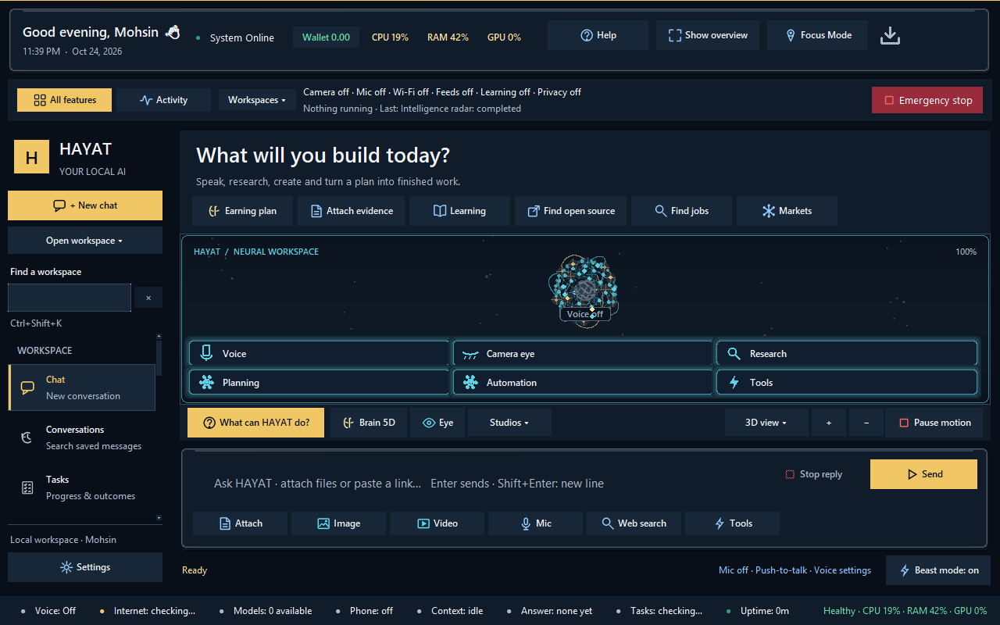
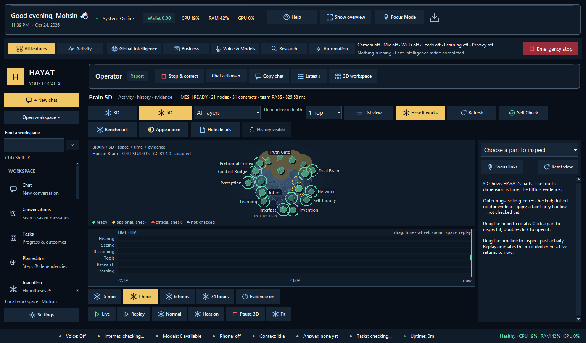

<div align="center">

# HAYAT

**A private, local-first AI assistant for Windows — your own AI that runs on your own computer.**

Talk to it, let it research the web, see through your camera and screen, use your apps, write code, make images and
video, track markets and jobs, and remember what matters — with a local language model and no cloud account.

[](LICENSE)


[](https://huggingface.co/Mohsinkhanshaik/HAYAT-35B-A3B-Uncensored-GGUF)

[Quick start](#quick-start) · [What it can do](#what-it-can-do) · [How to use it](docs/how-to-use-hayat.md) ·
[Roadmap](ROADMAP.md) · [Contributing](CONTRIBUTING.md) ·
[Discussions](https://github.com/mohsinkhanshaik/HAYAT/discussions) · [Models](#models)



</div>

---

## Why HAYAT

- **Private by default.** The language model, memory, files and camera stay on your machine. Nothing leaves it unless
  you ask. Web reading can go through Tor.
- **Zero-cost.** No paid APIs, no subscriptions. Paid fallbacks are blocked by policy, not by promise.
- **It acts, and proves it.** HAYAT runs real tools — files, browser, Windows apps, research, media — and only says
  something was done when the tool result shows it. Anything that touches the outside world waits for your approval.
- **It tells the truth about itself.** It says when it does not know, when a step failed and why, and cites the pages
  it read. Answers are plain language, never raw data dumps.
- **One assistant, many surfaces.** Desktop app, voice, terminal and an authenticated web client share one runtime.

## What it can do

| Area | Highlights |
| --- | --- |
| **Talk and think** | Natural chat with a local 35B mixture-of-experts model; deep reasoning mode; corrections remembered |
| **Voice** | Push-to-talk or hands-free, local speech recognition and speech output |
| **Research** | Background web research with cited sources, freshness and conflict checks; optional Tor and onion research |
| **See** | Webcam and screen understanding, text reading (OCR), person detection, consent-only face enrollment |
| **Use your computer** | Open and drive Windows apps by control name, browse websites, fill forms with your OK |
| **Create** | Images (SDXL) and short local video clips, documents, PDFs and Word files, code |
| **Remember** | Long-term memory with recall, a running picture of what you are working on, and lessons from past mistakes |
| **Work and money** | Job search with CV matching, business planning, invoices, a read-only Trade Center for crypto and stocks |
| **World awareness** | Global intelligence: public cameras, hazards, weather, satellites and news on a live map |
| **Privacy tools** | Tor masking, location-exposure checks, network guard, secret redaction, Windows Hello owner checks |
| **Build** | Reverse-engineering workbench, code tools, automations and reminders, worker teams for bigger jobs |

The full list — 40 areas, each with words to say and the window to open — is in **[How to use HAYAT](docs/how-to-use-hayat.md)**.

### Feature status

| Capability | Status | Notes |
|---|---|---|
| Conversation and agent loop | Working | One shared core for text and voice |
| Public-web research | Working | Free provider chain; web content is treated as untrusted data |
| Windows and browser control | Working | Permissioned, observed and verified |
| Voice | Working | Local speech in and out |
| Camera OCR | Working | Windows OCR first, bundled Tesseract as fallback |
| Image and video generation | Working | Local stable-diffusion.cpp engine on your GPU |
| Tor web reading | Working | Remembered on/off; starts on demand; never silently falls back to direct |
| Fine-tuning | Gated | Local QLoRA path exists; promotion requires passing held-out evaluation |

## Quick start

**You need:** Windows 10/11, Python 3.11 or newer (developed and tested on 3.14), [Ollama](https://ollama.com),
about 30 GB free disk for the default model, and ideally an NVIDIA GPU with 8 GB VRAM (CPU works, slower; RAM 32 GB+
recommended for the 35B model).

```powershell
# 1. Get the code
git clone https://github.com/mohsinkhanshaik/HAYAT.git
cd HAYAT

# 2. Install Ollama and HAYAT's brain from Hugging Face (22 GB, includes vision)
winget install Ollama.Ollama
ollama pull hf.co/Mohsinkhanshaik/HAYAT-35B-A3B-Uncensored-GGUF:Q4_K_M
ollama cp hf.co/Mohsinkhanshaik/HAYAT-35B-A3B-Uncensored-GGUF:Q4_K_M qwen3.6-35b-a3b-uncensored:q4_k_m

# 3. Set up and start
.\setup.ps1          # virtual environment, dependencies, embeddings, and the hayat model
python run.py        # opens the desktop app
```

On a smaller machine, use the 4B model instead:
`ollama pull hf.co/Mohsinkhanshaik/HAYAT-Open-4B:Q4_K_M` and select it in **Models**. Run
`python scripts/doctor.py` any time to see what is installed and what is missing. More detail:
[getting started](docs/getting-started.md) and [troubleshooting](docs/troubleshooting.md).

## Models

| Model | Size | Use |
| --- | --- | --- |
| [HAYAT-35B-A3B-Uncensored-GGUF](https://huggingface.co/Mohsinkhanshaik/HAYAT-35B-A3B-Uncensored-GGUF) | 22 GB | The default brain (Qwen3.6-35B-A3B, about 3B active per token), with vision |
| [HAYAT-Open-4B](https://huggingface.co/Mohsinkhanshaik/HAYAT-Open-4B) | 2.5–4.3 GB | Small experimental model for lighter machines |

HAYAT works with any Ollama model; see [models](docs/models.md).

## How it is built



- **Python** desktop app (Tkinter), local **Ollama** for language and vision, **stable-diffusion.cpp** for media,
  **Playwright** for browsing and **Windows UI Automation** for apps.
- 597 modules, about 166,000 lines, **7,865 automated tests** (7,738 run offline in about 20 minutes; 127 opt-in live checks
  against real models and networks).
- Every tool is registered with a permission class; every action is checked against its result before HAYAT claims it.
- Start reading at [architecture](docs/architecture.md) and the [technical tour](docs/technical-tour.md).

## Help make it more powerful

HAYAT is built in the open, and the next steps are clear. The [roadmap](ROADMAP.md) lists them, each with an open issue:

- **More honest, more uncensored answers** — measure false refusals and unrequested disclaimers, and evaluate
  newer uncensored local models ([#1](https://github.com/mohsinkhanshaik/HAYAT/issues/1),
  [#2](https://github.com/mohsinkhanshaik/HAYAT/issues/2)).
- **Deeper reasoning** — verify multi-step answers before replying
  ([#3](https://github.com/mohsinkhanshaik/HAYAT/issues/3)).
- **Faster and broader** — quicker start, more free research sources, Linux support, a good default for small
  machines ([#5](https://github.com/mohsinkhanshaik/HAYAT/issues/5)–[#7](https://github.com/mohsinkhanshaik/HAYAT/issues/7),
  [#10](https://github.com/mohsinkhanshaik/HAYAT/issues/10)).
- **First contribution?** Start with a
  [good first issue](https://github.com/mohsinkhanshaik/HAYAT/labels/good%20first%20issue).

Read **[CONTRIBUTING.md](CONTRIBUTING.md)** for the layout, how to run the tests, and the few rules every change
follows (code + tests + docs, honest results, no paid services). Security problems: see [SECURITY.md](SECURITY.md).

## Talk to the creator

Questions, ideas, show-and-tell, or want to work on HAYAT together? Start a thread in
**[Discussions](https://github.com/mohsinkhanshaik/HAYAT/discussions)** — that is the best way to reach me.
Bugs go in [Issues](https://github.com/mohsinkhanshaik/HAYAT/issues).

## Free, forever, and yours to run

HAYAT runs entirely on **your** computer. There is no server to depend on and nobody else's machine needs to be on:
once installed, your copy works on its own. It costs nothing — no account, no subscription, no paid API; paid
services are blocked by policy. GitHub and Hugging Face downloads are free.

## Licence

HAYAT is free software under the [GNU AGPL-3.0](LICENSE): use it, study it, change it and share it. If you distribute
a changed version, or offer it to others over a network, share your source under the same licence. Two additional
terms in [NOTICE](NOTICE) keep its origin visible: every copy keeps the credit **"HAYAT, created by Mohsin Khan
Shaik"**, and changed versions say they are based on HAYAT rather than presenting themselves as the original.
Third-party components keep their own licences — see [NOTICE](NOTICE).

**HAYAT was created by [Mohsin Khan Shaik](https://github.com/mohsinkhanshaik).**
