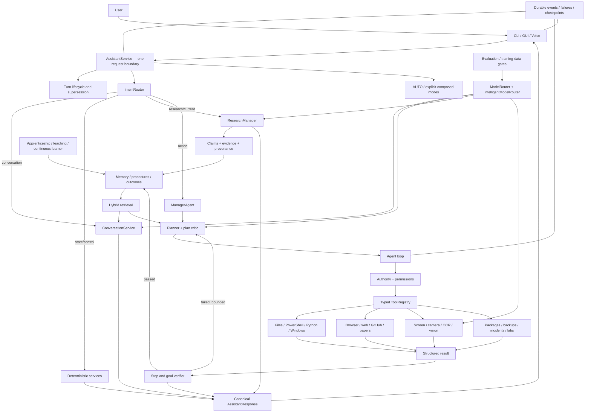
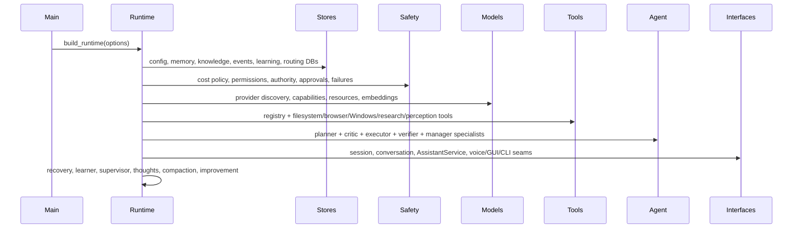
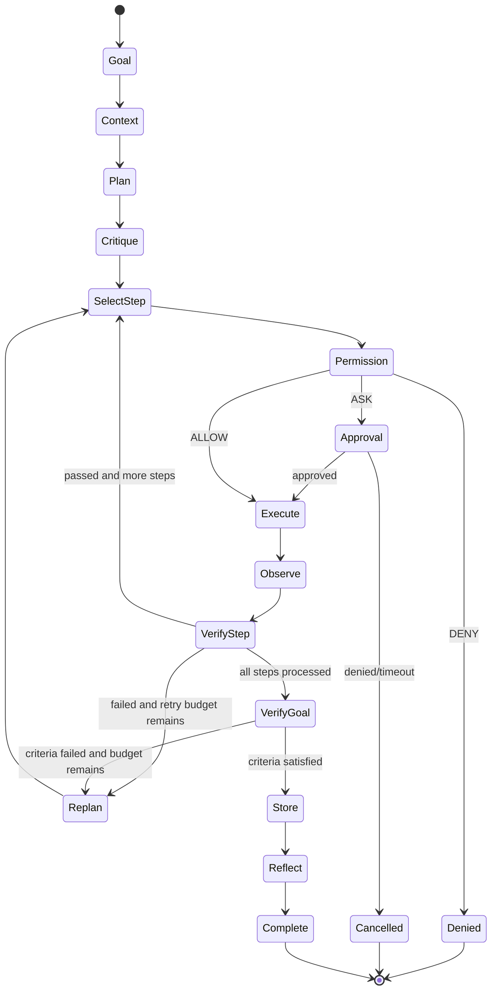
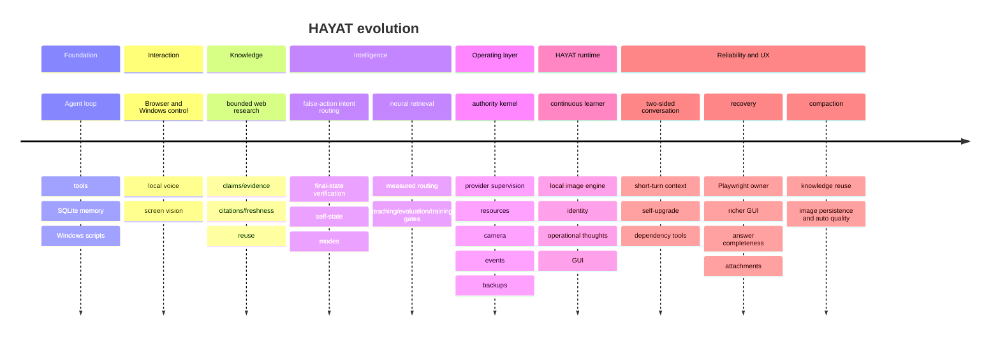

# HAYAT / D:\AI — Complete System Architecture, Orchestration, Code Atlas, and Critical Audit

> **Snapshot date:** 20 August 2026  
> **Repository snapshot:** `796e2ad544b488bfa84de0e89070a4871c59d3c2` (`master`)  
> **Audit mode:** source, configuration, Git, artifact, and live local-model inspection only  
> **Change made for this audit:** this document only; no application code or configuration was changed  
> **Important evidence rule:** “implemented,” “configured,” “measured,” and “currently hardware-tested” are different claims. This document keeps them separate.

## 1. Executive summary

HAYAT is not one chatbot class and it is not one language model. It is a local-first Windows agent runtime composed from several independent control layers. The language model supplies interpretation and generation where useful, but it does **not** have final authority over actions or truth. Deterministic intent routing, task-scoped authority, typed tools, observation, verification, structured responses, durable state, and recovery surround the model.

The shortest correct description is:

```text
HAYAT = one shared runtime
      + one authoritative request boundary
      + deterministic and model-assisted routing
      + planner/executor/verifier action loop
      + permission and authority kernel
      + local/cloud-compatible model adapters
      + Windows/browser/research/perception tools
      + SQLite memory/knowledge/evidence
      + CLI/GUI/voice interfaces over the same core
```

The codebase currently contains **319 Python source/test/script files and 40,091 Python lines** when `.venv`, `data`, bytecode, and `__pycache__` are excluded. The checked-in generated runtime reference describes **90 model-independent tools**, with `analyze_screenshot` added conditionally when a usable vision provider is configured. There are **95 Python test files**. These counts describe source shape, not proof that every path is healthy.

The latest documentation records **985 passing tests and a passing runtime doctor on 17 August 2026**. The last full evaluation artifact on 13 August ran an earlier 106-test suite plus behavioral benchmarks. Several large commits landed on 18–20 August after those baselines. This audit deliberately did not run tests or hardware because the request was documentation-only. Therefore, current HEAD must **not** be described as fully revalidated merely from those older numbers.

## 2. What is the “main brain”?

There is no single honest answer. “Brain” has several meanings in this architecture:

| Meaning | Actual component | Responsibility | What it must not do |
|---|---|---|---|
| Composition brain | `app/runtime.py::build_runtime()` | Constructs and connects every service, provider, store, tool, agent, UI adapter, and background worker | Decide user intent or fabricate runtime state |
| Turn brain | `app/assistant.py::AssistantService` | Owns one typed/voice request from intent through final canonical response | Bypass authority or invent success |
| Meaning gate | `app/intent/router.py::IntentRouter` | Separates conversation, questions, state, memory, research, controls, learning, and actions; blocks false actions | Treat ordinary speech as permission to act |
| Language brain | Routed `ModelProvider` | Produces conversation, plans, classifications, synthesis, code, or vision descriptions | Authorize tools or be trusted about completed actions |
| Action brain | `app/agent/core.py::Agent` | Runs bounded plan → action → observation → verification → retry/replan | Loop forever or declare success without evidence |
| Control brain | `app/safety/authority.py::AuthorityManager` plus `PermissionManager` | Gives the final deterministic answer to “may this action run?” | Be relaxed by website/model instructions |
| Truth brain | `Verifier`, `AssistantResponse`, state service, evidence stores | Checks actual results and prevents unsupported success responses | Equate fluent text with evidence |
| Memory brain | SQLite memory + retrieval + knowledge graph | Recalls experience, facts, procedures, claims, projects, and learning state | Retrain model weights merely by storing text |
| Interface brain | CLI, GUI, voice manager | Presents and captures interaction while sharing the same runtime | Become a second independent agent |

Operationally, `AssistantService` is the central turn orchestrator. Architecturally, `Runtime` is the central dependency graph. For safety, `AuthorityManager` is supreme. For natural-language ability, the selected local model is the generative brain. None is sufficient alone.

## 3. Whole-system figure



### Layer stack

| Layer | Question answered | Representative modules |
|---|---|---|
| 1. Interface | How does the user communicate? | `main.py`, `cli.py`, `gui.py`, `voice/*` |
| 2. Turn control | Which request is active and what response is authoritative? | `assistant.py`, `turns.py`, `responses.py`, `output.py` |
| 3. Meaning and mode | Is this talk, a question, research, learning, or an action? | `intent/*`, `modes.py`, `identity.py`, `answers.py` |
| 4. Context | What does this request refer to? | `session.py`, `projects.py`, `context_budget.py`, `attachments.py` |
| 5. Cognition | Which model/strategy should reason? | `models/*`, `agent/conversation.py`, `agents/manager.py` |
| 6. Deliberation | What are the steps and success criteria? | `agent/context.py`, `planner.py`, `critic.py` |
| 7. Authority | Is each proposed action allowed for this principal and task? | `safety/*`, `policy/cost.py` |
| 8. Capability | What can the system actually do? | `tools/*`, `windows/*`, `perception/*`, `research/*` |
| 9. Evidence | What actually happened? | `executor.py`, `verifier.py`, `state.py`, `failures.py` |
| 10. Persistence | What should survive restart? | `memory/*`, `events.py`, knowledge/training databases |
| 11. Improvement | What patterns, lessons, evaluations, or proposals follow? | `learning/*`, `apprenticeship.py`, `selfimprove.py`, `evaluation/*`, `training/*` |

## 4. Startup and dependency orchestration

`main.py` is the process entry point. It deliberately calls `reserve_window()` before importing/building the full runtime so Tk drag-and-drop can initialize OLE in a single-threaded apartment before Windows automation libraries initialize COM differently. This is a Windows-specific ordering constraint, not cosmetic code.

Supported entry modes include GUI, CLI-only, voice-only, combined CLI+voice, tray, scheduler daemon, and one-shot goal/JSON execution. One-shot mode disables background services so machine-readable output is not contaminated by a learner, voice thread, or console narration.

`build_runtime()` in `app/runtime.py` is the composition root. In simplified construction order it creates:



`Runtime.close()` is idempotent. It records a clean-exit marker, then stops voice, continuous learning, camera sessions, scheduler, browser/research resources, and event infrastructure. Crash recovery detects an unclean marker and reconciles interrupted work as interrupted; it does not silently resume an unsafe action.

## 5. One request, end to end

### 5.1 Turn lifecycle

1. CLI, GUI, or voice calls the same `AssistantService.handle(text, source)`.
2. A `TurnRecord` is created and advanced through structured statuses.
3. A newer user turn supersedes older active turns. Late results from an older worker cannot overwrite the newer conversation.
4. The intent router normalizes text and classifies meaning.
5. Modes, child/guardian policy, privacy state, session references, and active project are added.
6. The request follows a deterministic, conversational, research, learning, diagnostic, or action path.
7. Exactly one `AssistantResponse` is produced with a status and required deliverable type.
8. Display and spoken renderers consume that same response; voice shortens it but cannot change whether the task succeeded.

### 5.2 False-action boundary

Greetings, acknowledgements, descriptions, and questions must not accidentally reach tools. Tiny deterministic routes handle immediate controls and known self-state requests. The model is a fallback classifier, not the sole safety boundary. The router also rejects a bare generic greeting emitted by a classifier where a substantive classification/answer was required—the source of the past “Hello! How can I assist you today?” failure.

### 5.3 Conversational continuity

`session.py` holds current application/window/file/browser/task references. Conversation records persist by `session_id`. Short replies are attached to the existing conversational thread when context supports it, so “run its tests” can refer to the repository just opened. This is bounded reference resolution, not human-level persistent awareness; ambiguous referents still require clarification.

### 5.4 Answer completeness

`answers.py` detects requested depth (`QUICK`, `NORMAL`, `DETAILED`, `DEEP`, `RESEARCH`), decomposes multi-part questions, checks the provider finish reason, looks for missing topics and truncated endings, issues a specific continuation request, and merges continuation text while removing repeated seams. This fixes premature stopping, but topic coverage is lexical/heuristic and can still accept a shallow paragraph that happens to mention the right words.

### 5.5 Canonical response invariant

`responses.py` defines statuses such as `SUCCESS`, `PARTIAL`, `FAILED`, `CANCELLED`, `WAITING_APPROVAL`, and `DEGRADED`, plus deliverable types such as answer, artifact, state, action result, and research. `MissingDeliverable` prevents code from claiming success while omitting the thing requested. This is a strong transport invariant; it does not prove that the content itself is factually perfect.

## 6. Action loop: plan, act, observe, verify, recover



`Planner` first recognizes deterministic common workflows. It otherwise asks the selected provider for a typed JSON plan, validates tool names and arguments, strengthens expected results, and has a safe fallback. `critic.py` structurally reviews complex plans. `Executor` resolves references to prior step outputs and invokes only registered tools. `Verifier` checks structured tool evidence at step level and checks explicit user success criteria at task level. `Agent` limits steps to 20 and retries per step to 2 by current configuration.

Examples of verification semantics:

| Action | Evidence expected |
|---|---|
| Write file | Handler result, real path existence, and optionally read-back/content match |
| Run program/tests | Exit code plus relevant stdout/stderr |
| Browser navigation | Current URL/title/DOM after navigation |
| Click | Post-click URL/title/accessibility/DOM state, not “click returned” alone |
| Type in Notepad | UI Automation reads the editor back and confirms the requested text |
| Close window | The exact intended window handle disappears; unsaved dialog becomes a choice |
| Generate image | A real PNG exists, can be decoded, is hashed, and is recorded in the manifest |

Failure classification and replanning are bounded. Failures are stored in structured form. The repair specialist diagnoses recorded evidence rather than guessing. Recovery notices interrupted tasks after a crash but resumes nothing automatically.

## 7. Model architecture and actual installed models

### 7.1 Common provider contract

`app/models/base.py` defines `Message`, `ModelResponse`, `ModelError`, and abstract `ModelProvider`. Providers normalize messages and return text, tool calls, usage, finish reason, and metadata in one shape. Provider-specific errors retain endpoint/status/diagnostic evidence.

Implemented adapters:

| Provider/engine | Module | Protocol | Current default availability |
|---|---|---|---|
| Ollama | `models/local.py::OllamaProvider` | Native `/api/tags`, `/api/show`, `/api/chat`, vision and embedding endpoints | Live and primary local route |
| LM Studio / OpenAI-compatible | `models/local.py::OpenAICompatibleProvider` | `/v1/models`, chat completions, vision where supported | Supported; depends on a running endpoint/model |
| OpenAI | `models/cloud.py::OpenAIProvider` | OpenAI-compatible | Adapter implemented, blocked by shipped zero-cost/cloud policy |
| Anthropic | `models/cloud.py::AnthropicProvider` | Messages API | Adapter implemented, blocked unless explicitly configured/allowed |
| Gemini | `models/cloud.py::GeminiProvider` | `generateContent` | Adapter implemented, blocked unless explicitly configured/allowed |
| Owned llama.cpp | `models/llama_cpp.py` | Locally supervised server | Implemented for downloaded GGUF models |
| Local GGUF inventory | `models/gguf.py` | Metadata/provenance inspection | Implemented; availability depends on files |
| Diffusion image engine | `models/diffusion.py` | Local `stable-diffusion.cpp` child process | Installed SD 1.5 checkpoint; separate from LLM routing |

The shipped cost policy is `ZERO-COST`: paid APIs, cloud inference, cloud embeddings, cloud TTS, cloud STT, and paid search are false. Cloud compatibility is architecture, not active use.

### 7.2 Live Ollama inventory on this audit date

| Model | Live size | Advertised/measured role |
|---|---:|---|
| `all-minilm:latest` | 45 MB | 384-dimensional local embeddings; 512-token input in recorded benchmark |
| `qwen:latest` | 2.3 GB | Fast completion/classification candidate |
| `gemma4:latest` | 9.6 GB | Completion, vision, audio, tools, thinking advertised; large disk model |
| `llama3:latest` | 4.7 GB | Recorded reasoning/coding/research-synthesis selection |
| `qwen3.5:latest` | 6.6 GB | Classification/fallback candidate; no longer the conversation/vision primary |

Recorded 13 August point-in-time generation speeds ranged from 41.72 to 72.53 tokens/s and loaded VRAM from about 3.23 to 5.49 GB. Those are small benchmark probes, not general intelligence scores. Every tested model scored zero on the benchmark’s complete planning workflow, which is why critical common workflows remain deterministic and verified.

### 7.3 Routing

`ModelRouter` performs provider discovery and purpose resolution. `IntelligentModelRouter` adds task intent, complexity, modality, privacy, latency budget, output format, modes, measured capability, past verified outcomes, warm/cold state, RAM/VRAM fit, and bounded fallback. It returns one primary and at most two fallbacks. `BoundedFallbackProvider` does not loop indefinitely.

Recorded purpose selection:

| Purpose | Selected model in benchmark artifact |
|---|---|
| Classification | `qwen:latest` |
| Conversation | `gemma4:latest` |
| Reasoning | `llama3:latest` |
| Coding | `llama3:latest` |
| Research synthesis | `llama3:latest` |
| Vision configuration | `qwen3.5:latest` primary (since 2026-09-30); `gemma4:latest` stays installed as a fallback |

The adaptive router stores only verified model-task outcomes in `model_routing.db`; unverified self-praise cannot reinforce a route. Warm-model preference is subordinate to capability and quality. Resource gating serializes heavy work and may refuse a model/image load that does not fit.

### 7.4 Model limitations

- Capability tags say an interface exists; they do not prove visual or reasoning correctness.
- The model benchmark is tiny and role-specific. A score of 1.0 on three probes is not “perfect reasoning.”
- Local models can produce invalid JSON, hallucinations, repetition, shallow answers, and confident mistakes.
- 8 GB-class VRAM makes large contexts and simultaneous diffusion/LLM work difficult; CPU spill can turn seconds into minutes.
- Recent settings enable automatic idle-model eviction for explicit image generation, while older documentation still says eviction is disabled. The code/config at this snapshot is authoritative; the documentation conflict is itself a flaw.

## 8. Memory, knowledge, learning, and what “learn” actually means

### 8.1 Memory types

| Type | Purpose | Store |
|---|---|---|
| Working | Active goal/task/session state | task/checkpoint/session records |
| Episodic | What happened in past tasks | `memories`, `actions`, `tasks`, conversations |
| Semantic | User facts and useful facts | `memories` with type/state metadata |
| Procedural | Reusable successful methods | `procedures`, skill candidates |
| Research knowledge | Claims tied to retrieved sources | `knowledge.db` claim/evidence graph |
| Learner state | Topics, mastery, review, labs | learning databases and journal |
| Model experience | Verified route outcomes | `model_routing.db` |

### 8.2 Current database reality

At audit time, read-only SQLite inspection found:

| Database | Notable live contents |
|---|---|
| `data/memory/agent.db` | 264 tasks, 384 actions, 4,982 conversation rows, 542 memories, 2 procedures, 246 retrieval objects, 245 retrieval vectors, 279 checkpoints |
| `data/knowledge/knowledge.db` | 589 claims, 609 evidence rows, 248 sources, 82 research runs, 79 synthesized knowledge rows, 1,104 entities, 419 relationships |
| `data/learning/learning.db` | 36 queued background-learning topics |
| `data/memory/authority.db` | 1,277 audit decisions, one stored grant, two authority settings |
| `data/memory/events.db` | 11,775 durable structured events |
| `data/memory/model_routing.db` | 86 model-task outcomes |
| `data/training/registry.db` | 3 training records; no registered model versions |
| `data/tool_understanding.db` | 108 summarized tool-call outcomes |

Counts show persistence is active. They do not prove every row is high-quality or non-duplicative.

### 8.3 Hybrid retrieval

```text
query
  ├─ lexical overlap
  ├─ local all-minilm embedding similarity
  ├─ hashed-semantic fallback
  ├─ entity match
  ├─ active-project relevance
  ├─ recency
  ├─ confidence and importance
  └─ verified successful-use history
       ↓
candidate merge → dedupe → weighted ranking → top context
```

Content is normalized and hashed. Unchanged content reuses cached embeddings; model/version/dimension are recorded. Secret-like content, raw logs, binaries, and debug noise are not eligible. Reindexing is controlled. Query embeddings are not stored as user memories.

The recorded 100-case benchmark selected semantic-heavy hybrid weights:

| Strategy | Precision@1 | Recall@5 | MRR | nDCG@5 | False top-memory rate | Mean latency |
|---|---:|---:|---:|---:|---:|---:|
| Lexical only | 0.32 | 0.41 | 0.361 | 0.373 | 0.68 | 5.9 ms |
| Semantic only | 0.82 | 0.95 | 0.876 | 0.895 | 0.18 | 512.6 ms |
| Selected hybrid | 0.85 | 0.95 | 0.894 | 0.908 | 0.15 | 478.5 ms |

The numbers reveal a real flaw: even the chosen benchmark had a **15% wrong top result**. Retrieval is useful, not infallible. Optional reranking remains disabled because no separately validated quality/latency benefit exists.

### 8.4 Knowledge graph and research memory

Research stores sources, retrieval time, publication/update time where present, content hashes, quality, primary/independence metadata, claims, evidence excerpts, stance, confidence, validity windows, entities, relationships, history, conflicts, and supersession. New evidence does not silently erase older evidence. `knowledge.py` can recall fresh verified results before repeating research, but reuse must pass relevance and freshness thresholds.

### 8.5 Compaction and attachments

`attachments.py` ingests explicitly dropped/selected text, PDF, and images; extracts/summarizes them; and can make bounded content retrievable with provenance. External documents remain untrusted data. `memory/compaction.py` summarizes older conversational material while retaining recent whole turns and creates a backup before destructive compaction. Compression saves context/disk but necessarily loses detail; summaries must not be treated as exact transcripts.

### 8.6 Continuous learning

`learning/continuous.py` is an idle-only background researcher under the special `BACKGROUND_LEARNER` principal. It has persistent hourly/daily budgets, CPU/idle checks, a wakeable durable queue, deep verified-knowledge storage, fresh-knowledge reuse, and a `data/learning/STOP` kill switch. For safe public-world questions it can prepare at most two deterministic follow-up angles. A RAM-indexed subject-and-intent gate must match a later question before prepared knowledge is reused; a related-but-different question gets fresh research. It can read public evidence and write its governed knowledge store. It cannot click/type, launch apps, use sensors, submit forms, reach private systems, or rewrite arbitrary files.

Configured ceilings are 60 cycles/hour, 300 requests/hour, 4 GiB/day, 300 seconds/cycle. The learner runs continuously and is paused for the duration of each conversational turn rather than held off by a keyboard-idle rule. These are generous and can still create network load and low-value knowledge if topic selection is poor.

“Learning” here means retrieval, durable facts, procedures, mastery state, research, compression, and routing evidence. It does **not** update the underlying LLM weights. Fine-tuning execution is intentionally disabled.

## 9. Research architecture

`ResearchManager` routes bounded research, not unrestricted crawling:


Research budgets are fast (2 searches/5 pages/30 s/5 MiB), normal (5/15/90 s/20 MiB), and deep (10/40/240 s/60 MiB). Concurrency is capped at three and robots.txt/rate delay are configured. Public GitHub research uses the official API where possible. Paper research extracts only fields actually found. Browser fallback uses an isolated Playwright context and treats page text as data.

Prompt injection is separated from the control plane: a webpage can suggest text but cannot expand permissions, open an authority envelope, read credentials, or authorize a tool. Citations fail closed if the source was not retrieved, the content hash/excerpt mismatches, or the claim is unsupported.

Important limits:

- Citation integrity proves the cited bytes were retrieved and matched; it does not make the source true.
- Source quality, independence, contradiction, and claim-support scoring are heuristics.
- The recorded research-quality benchmark itself documents imperfect citation correctness/completeness and an evaluator bug that was later narrowed.
- Search provider changes, blocked pages, CAPTCHAs, JavaScript, robots rules, and network errors can leave gaps.
- A cached answer can become stale; freshness classes and validity windows reduce but do not remove this risk.

## 10. Safety, permissions, and authority

Safety is layered because a single YAML flag is not enough:

1. `config/permissions.yaml` defines static `ALLOW`, `ASK`, and `DENY` categories, allowed roots, protected paths, command profiles, and dangerous patterns.
2. `PermissionManager` validates categories, commands, and normalized filesystem paths.
3. `CommandPolicy` tokenizes command segments, checks safe profiles, detects protected resources, obfuscation, elevation, destructive patterns, and denied binaries.
4. `AuthorityManager` evaluates principal, risk tier, privacy state, trusted-owner mode, scoped grants, and a task authority envelope.
5. `ToolRegistry` routes every invocation through both static policy and runtime authority.
6. The verifier checks the result; permission is not evidence of success.

Current protected areas include Windows, Program Files, browser credential profiles, SSH/AWS/Kubernetes/GPG credentials, Microsoft credential stores, `.env`, key/certificate formats, and the project’s own authority/security files. System-file deletion, system modification, financial transactions, purchases, credential access, and access-control bypass are denied. Administrator PowerShell remains `ASK` even in owner mode.

The configured filesystem roots are broad (`D:\` plus user libraries and project). That is deliberately powerful and materially increases blast radius. Protected paths and high-risk classification reduce risk, but cannot make broad write/delete access equivalent to a VM sandbox. The current `filesystem_delete: ALLOW` comment also conflicts with the generated tool description saying deletion always requires approval; runtime authority/risk tier decides the real outcome. Such policy/document divergence is a maintainability flaw.

Voice input is not stronger authority than typed text. High-consequence approval requires explicit phrases. Privacy mode can block network/sensors regardless of static `ALLOW`. External web/audio/document content never becomes a principal.

## 11. Tools and operating capabilities

Every tool has a name, description, JSON input schema, risk, permission category, and handler. The registry tracks outcome counts and latencies without persisting prior sensitive arguments/output. Major tool families:

| Family | Implemented capabilities | Preferred evidence |
|---|---|---|
| Filesystem | list/read/write/append/create/copy/move/search/exists/info/delete | resolved path, existence, read-back, hashes |
| Shell | terminal and non-admin PowerShell with cwd/stdout/stderr/exit/timeout | exit code and captured streams |
| Python | generated code and existing file execution in project work area | exit code/output/import/result |
| Applications | discover/launch/open project/close exact window | process/window/UIA state |
| Windows input | screenshot, move/click/type/key/hotkey/scroll | observe → act → observe |
| Browser | launch/navigate/tabs/DOM/accessibility/find/click/type/scroll/extract/download/screenshot | URL/title/DOM/accessibility after action |
| Research | search/fetch/API/crawl/GitHub/papers/knowledge/explain/export/import/monitor | retrieved source + hash + evidence |
| Perception | monitors, screen, clipboard, camera, OCR, vision | fresh capture/geometry/OCR/model metadata |
| Images | local generation/status/history | decodable retained PNG + SHA-256 + manifest |
| Operations | packages, downloads, backups, incidents, labs, system status | deterministic checks and manifests |
| Introspection | authoritative self-state and tool understanding | live services and recorded outcomes |

Browser automation uses a dedicated owner thread (`browser_host.py`) because Playwright objects are thread-affine. This fixes cross-thread access but serializes browser work and makes the owner thread a bottleneck/single failure point.

Windows automation prefers UI Automation and exact window handles over raw coordinates. Coordinate input still exists and remains inherently fragile under scaling, layout changes, animation, occlusion, and multi-monitor differences.

## 12. Vision, camera, clipboard, and image generation

Perception order is deliberately:

```text
structured Windows/DOM state > accessibility/UIA > OCR > pixels > vision model
```

Screenshots can be captured without a vision model. Interpretation fails closed when no vision provider is usable. Vision output alone cannot authorize a high-risk click. `qwen3.5:latest` is configured for local vision, with `gemma4:latest` retained as an installed fallback; a successful image request proves plumbing, not correct recognition.

Camera access is explicit, visible, time-bounded, and managed by sessions/watchdogs. Temporary observation frames are deleted unless retention is deliberately enabled. OCR has a Windows Media backend with a recorded small synthetic benchmark; paths and dense punctuation were its weak cases. Camera vision is affected by lighting, focus, occlusion, and model error.

Clipboard content is treated as ephemeral and redacted from durable task history. Explicit reading still exposes it to the current local model/task, so privacy risk remains.

Image generation uses a locally retained Stable Diffusion 1.5 checkpoint (`sd-v1-5-pruned-emaonly.safetensors`, recorded size 4,265,146,304 bytes and SHA-256 provenance) through a local diffusion engine. It supports auto/fast/balanced/quality presets, prompt styles, negative guidance, adaptive dimensions, seed capture, PNG decoding/verification, manifest entries, hashes, and legacy-image discovery. Artifacts live under `data/artifacts/images`.

Limitations are substantial: SD 1.5 is old, weak at text, hands, composition, prompt fidelity, and high-resolution detail compared with newer image models. Prompt enhancement cannot replace a better checkpoint. GPU memory contention with an LLM can force model eviction or CPU fallback. “Image generation improved” here means better presets, provenance, persistence, and routing—not a newer base model.

## 13. Voice architecture

```text
microphone → push-to-talk/VAD/wake phrase → local STT
→ AssistantService (same typed path)
→ canonical response → concise spoken formatter → local TTS → speaker
```

The default is push-to-talk on `Ctrl+Space`; optional continuous and wake-phrase modes exist. Faster Whisper `base.en` runs locally on CPU/int8 with 16 kHz mono input and configurable hotwords. Piper `en_US-lessac-medium` is installed locally (about 63 MB); Windows SAPI is a fallback. Playback is asynchronous and stoppable. Pressing push-to-talk during speech interrupts playback. Echo similarity filtering reduces self-trigger loops.

Immediate deterministic commands handle stop speaking, cancel task, mute/unmute, volume, and status. Stop-speaking and cancel-task are intentionally separate. Voice approvals require explicit language. Raw microphone audio is not retained and transcription text logging is off by default.

Weaknesses: wake mode is phrase matching over VAD/STT rather than a dedicated low-power wake model; environmental audio can trigger it. STT can mishear names and approvals. Echo rejection can suppress a legitimate similar response or miss a speaker echo. Hardware tests cannot programmatically judge naturalness. Hands-free audio, TTS, Whisper, model inference, and GUI threads can compete for CPU/RAM.

## 14. GUI and observable “thinking”

The Tkinter GUI is a view over the same `Runtime` and `AssistantService`; it is not a separate bot. The current UI includes conversation, composer, drag-and-drop attachments, navigation, collapsible toolbox/workspace, model chips, live console, resource gauges, health, voice/privacy/child controls, camera preview, files/research/learning/training/settings views, a live learning/research/training/permission rail, image controls, approvals, and sensor state.

Structured output is serialized through `OutputCoordinator`; workers publish rather than print into widgets. GUI work runs off the Tk thread and posts results back, preventing common freezes. Slow resource refreshes are separated from fast display ticks. Playwright has one owner thread.

The “thinking” view is an **operational trace**: selected route, plan creation, tools, progress, observations, retries, and verifier outcomes. It deliberately does not expose hidden model chain-of-thought. Exposing raw chain-of-thought would be misleading, noisy, privacy-sensitive, and is not required for auditability. The correct observable substitute is evidence-bearing lifecycle telemetry.

GUI flaws and risks:

- `app/gui.py` is about 4,000 lines and still owns substantial wiring and behavior; this is a maintenance hotspot despite extracted widgets in `gui_panels.py` and the operator (`gui_operator.py`), remote-access (`gui_remote.py`), vision (`gui_vision.py`) and startup (`gui_startup.py`) modules.
- Tkinter is lightweight but limited for modern accessibility, rich layout, animation, virtualization, and high-DPI polish.
- Drag/drop depends on OLE/COM initialization ordering and optional TkDND integration.
- Background callbacks and shutdown ordering are difficult to prove race-free across every device/provider failure.
- Saved workspace layout in `data/workspace.json` is user state, not versioned architecture.

## 15. Teaching, child supervision, labs, apprenticeship

`learning/manager.py` stores topic/concept mastery, confidence, correct/incorrect answers, labs, prerequisites, forgetting/review timing, and weak areas. It supports adaptive lessons, active recall, Socratic mode, exam mode, interview mode, and a hint ladder. Safe labs create simulated failures under `data/work/labs`, not real infrastructure outages.

`guardian.py` provides parent-controlled child profiles, content/permission boundaries, activity records, and reports. This is a supervision aid, not a certified parental-control product. It cannot guarantee that every generated sentence is developmentally appropriate, nor can it prevent a child from using other applications outside HAYAT.

`apprenticeship.py` observes verified repeated patterns, records lesson candidates, and can promote declarative procedures only after evidence/trust gates. `tool_understanding.db` tracks tool reliability summaries so the assistant can describe what its actual tools have done instead of hallucinating capabilities.

Recorded teaching evaluation contained 50 deterministic scenarios with 100% expected behavior and a sample mastery update. This measures the teaching state machine, not whether a human truly learned the subject.

## 16. Automation, specialists, packages, and self-change

The scheduler supports once/daily/weekly/interval/cron-like jobs with durable job/execution/checkpoint states and is enabled for persisted jobs. Scheduled and event-triggered goals run with restricted background authority rather than owner authority. Sleeping, powered-off, or disconnected hardware cannot execute jobs.

The manager exposes researcher, coder, computer, reviewer, and repair specialists. They are bounded views over the same core, not autonomous agents with separate authority. Repair is selected only for explicit self-repair patterns so normal “fix my project” requests do not mutate HAYAT itself.

Package installation checks package identity/near-miss risk and targets the project environment. Dependency upgrades require a health verifier. `SelfImprovement` reviews recorded failures, tool reliability, repeated patterns, and provider evidence; it can propose a change and has a rollback-safe source-change path. A change is not immediately trusted: it is Git-aware, protects dirty work, runs health checks, and rolls back on failure.

This is controlled self-maintenance, not unrestricted recursive self-rewriting. It still has risks: tests can miss behavioral regressions, dependency supply chains can be compromised, and a rollback cannot undo every external side effect. Authority/policy files are protected from ordinary agent file tools.

## 17. Evaluation and training pipeline

Evaluation categories include conversation, self-state, intent, tools, planning, goal completion, verification, memory/retrieval, research, coding, vision, voice, teaching, routing, Windows, and browser behavior. Golden cases fail a release gate. JSON and Markdown artifacts are stored under `data/benchmarks`.

The last full evaluation artifact (13 August, older code) reported:

| Evaluation | Result |
|---|---:|
| Earlier unit suite | 106 passed |
| Intent routing | 100/100; 0 false actions |
| Common tool selection | 12/12 |
| Contradictory verification | 6/6 detected |
| Self-state | 13/13 |
| Retrieval | 100 cases; metrics in §8 |
| Model routing | 200 cases; 100% expected route classification |
| Teaching | 50/50 state-machine scenarios |
| Integrated intelligence | 10/10 categories |
| Golden gate | passed |

The routing benchmark’s “100%” is a deterministic expected-route dataset, not proof the chosen model always answers correctly. Memory and citation hallucination metrics were `unknown`, correctly not reported as zero.

Training records move through `RAW`, `VALIDATED`, `REJECTED`, `TRAINING_READY`, and `HELD_OUT`. The pipeline redacts common secrets, hashes exact and normalized-semantic content, blocks cross-split duplicates, and creates train/validation/test splits. Owner-consented verified private samples are tagged `PRIVATE_LOCAL`, separated under category-private directories, and blocked from cloud export or automatic collection. The recorded isolated benchmark processed 62 samples into 52 train, 4 validation, 5 held-out, and 1 rejected record with no detected split contamination/secret leak.

`hayat:latest` is a distinct local Ollama identity package derived from the installed `qwen3.5:latest` instruction foundation. Its checked-in Modelfile, build hash, capabilities, and provenance are inspectable through `/hayat-model`; it does not claim from-scratch foundation training. A local-only LoRA/QLoRA entry point and candidate lifecycle are implemented, but have no automatic caller. The live private gate blocks execution until it has enough verified private samples, train/validation/test splits, and an owner-selected matching local Hugging Face checkpoint. After training, baseline/held-out, golden, safety, latency, explicit promotion, versioning, and rollback gates remain mandatory.

### 17.1 Key function and method map

The table below names the functions that carry the system's main control flow. Private helpers are intentionally described with their owner rather than reproduced line by line; source code remains the executable specification.

| Function or method | Input → output | Architectural job |
|---|---|---|
| `main.main()` | command-line arguments → process exit code | Select GUI, CLI, voice, combined, tray, scheduler, or one-shot operation |
| `runtime.build_runtime()` | startup options → `Runtime` | Construct the entire dependency graph and register capabilities |
| `Runtime.close()` | runtime state → clean shutdown | Stop owners/workers and mark clean exit idempotently |
| `AssistantService.handle()` | user text + source → `AssistantReply` | Authoritative typed/voice request boundary |
| `AssistantService._handle_inner()` | normalized request → routed response | Apply intent, mode, control, research, memory, conversation, or action path |
| `AssistantService._open_authority_envelope()` | intent + turn → scoped envelope ID | Carry explicit user authority across the bounded calls needed for one task |
| `AssistantService._outcome_response()` | verified task outcome → response text | Describe actual actions/results without generic false success |
| `IntentRouter.route()` | natural language/context → `RequestIntent` | Classify meaning and enforce the false-action boundary |
| `detect_depth()` / `required_topics()` | question/modes → depth/topics | Define what a complete answer owes |
| `assess()` / `continuation_request()` / `merge()` | partial model output → completed answer | Detect truncation/missing topics and continue specifically |
| `ConversationService.reply()` | text + history/retrieval/context → model text | Generate a contextual non-action answer with completeness controls |
| `IntelligentModelRouter.route()` | `RouteRequest` → primary/fallback decision | Select a model using capability, privacy, mode, resources, warmth, and verified evidence |
| `IntelligentModelRouter.record_outcome()` | verified task result → routing row | Learn route evidence without self-reinforcement from unverified text |
| `ModelRouter.get()` | purpose → provider | Resolve configured/benchmarked local provider and fail closed under cost policy |
| `Planner.create_plan()` | goal + context + intent → `PlanStep[]` | Prefer deterministic workflow, otherwise create/validate a model plan |
| `Planner.replan()` | failed step + evidence → revised steps | Change strategy within bounded retries |
| `Agent.run()` / `_run_task()` | goal → `TaskOutcome` | Own task/checkpoint/action/verification loop and cancellation |
| `Executor.execute()` | plan step + history → `ToolResult` | Resolve prior-step references and call the registry |
| `ToolRegistry.execute()` | tool name/arguments/context → `ToolResult` | Apply permission/authority, invoke handler, time and record outcome |
| `PermissionManager.check()` | permission category + arguments → static decision | Enforce paths, protected resources, and command policy |
| `AuthorityManager.evaluate()` | principal-aware `ActionRequest` → policy decision | Final deterministic ALLOW/ASK/DENY with tier, grants, privacy, and envelope |
| `Verifier.check()` | expected step state + result → `Verification` | Check the action's concrete result |
| `Verifier.check_goal()` | success criteria + history → `Verification` | Decide whether the user's final requested state is evidenced |
| `MemoryDatabase.*` | tasks/actions/memories/conversation → SQLite rows | Durable task and experience source of truth |
| `EmbeddingRegistry.from_config()` plus provider `capability()` | configured endpoints → embedding registry/status | Discover a real local embedding route/dimension rather than assume by name |
| `RetrievalIndex.sync()` / `reindex()` | persisted objects → metadata/vectors | Add eligible memory, knowledge, docs, skills, and learning notes to the hybrid index |
| `RetrievalIndex.search()` | query/project/strategy → ranked candidates | Merge lexical, neural, entity, project, recency, and quality signals |
| `ResearchManager.needs_research()` | goal → boolean | Detect current/uncertain/external knowledge needs |
| `ResearchManager.research()` | query + level/policy → `ResearchResult` | Run bounded search, fetch, extraction, validation, synthesis, and optional memory |
| `ResearchManager.recall_verified()` | query + thresholds → stored knowledge | Reuse sufficiently relevant/fresh evidence before another web pass |
| `ContinuousLearner` cycle methods | queued topic + budgets/idle state → verified knowledge or stop reason | Perform constrained unattended public learning |
| `LearningManager` lesson/assessment methods | topic + learner evidence → lesson/mastery/review | Adapt teaching from prerequisites, answers, hints, and lab performance |
| `VoiceManager.submit_transcript()` | recognized speech → `VoiceResponse` | Fast-command or shared-assistant path with interruption and concise speech |
| `VoiceApprovalController.answer()` | spoken phrase → approval/denial/unknown | Require explicit approval language and reject ambiguity |
| `HayatGUI.send()` / `_work()` | composer text → background assistant reply | Keep the Tk event loop responsive while using the shared assistant |
| `HayatGUI._tick()` / `_refresh_slow()` | runtime state → widgets | Render live fast/slow state without parsing prose as truth |
| `AttachmentReader.ingest()` | selected file → extracted/provenance-bearing attachment | Read user-provided text/PDF/image without treating it as instructions |
| `MemoryCompactor.preview()` / `run()` | old conversation rows → backup + summaries | Reduce repeated context while preserving recent detail and recoverability |
| `CrashRecovery.reconcile()` | unclean marker + active checkpoints → interrupted status | Report unfinished work without unsafe automatic resumption |
| `SelfImprovement.review()` / `apply()` | recorded failures/patterns → proposal/result | Turn evidence into controlled improvements, never silent recursive deployment |
| `SelfImprovement.change_own_code()` | explicit goal → checkpoint/change/tests/rollback | Apply a bounded Git-aware core change and restore on failed health checks |
| `EvaluationManager.run()` | level/cases → JSON + Markdown report | Enforce golden gates and comparable metrics |
| `TrainingDataPipeline` stage/validate/split methods | raw verified samples → gated datasets | Redact, deduplicate, validate, split, and withhold training execution |

### 17.2 Audit coverage boundary

“All code” in this document means every application package and architectural source area is mapped, and the functions that control cross-subsystem behavior are explained. It does **not** paste 40,091 source lines into a second stale copy. The repository source is authoritative for exact statements and helper implementations.

Generated/private runtime material is described by schema and purpose rather than enumerated by filename/content. In particular, `.env`, raw conversations, task logs, voice logs, screenshots, user artifacts, downloaded documents, database row content, and model binaries are not reproduced. This prevents an architecture document from becoming a secret/private-data dump. Bytecode, caches, virtual-environment packages, and Git internals are implementation artifacts, not project architecture.

## 18. Storage and data map

The configured project ceiling is 3 TB with 300 GB reserved free space and a 1 TB learning-category quota. These are **ceilings**, not physically reserved space. Automatic cleanup is conservative: disposable caches/work, duplicate quarantined downloads, expired research cache, and old disposable screenshots. It does not treat knowledge, models, user artifacts, backups, generated images, or training data as disposable.

| Path | Meaning | Durability/privacy |
|---|---|---|
| `data/memory/agent.db` | tasks, actions, conversations, memories, vectors, procedures | durable; sanitized |
| `data/memory/authority.db` | grants/settings/audit | protected security state |
| `data/memory/events.db` | structured lifecycle events | durable; redacted |
| `data/knowledge/knowledge.db` | sources, claims, evidence, relationships, runs, cache | durable provenance |
| `data/learning/` | queue, journals, guardian activity | durable learning state |
| `data/artifacts/` | user/task reports, screenshots, generated images | durable unless explicitly disposable |
| `data/work/` | controlled execution and labs | working/disposable by policy |
| `data/downloads/` | quarantined public downloads and ledger | never auto-executed |
| `data/models/` | Whisper and diffusion models | large durable local files |
| `data/voices/` | Piper voice | durable local model |
| `data/training/` | staged datasets and registry | gated; secret-redacted |
| `data/logs/` | task, privacy-limited voice, and redacted process (`hayat.log`) logs | ignored, potentially sensitive |
| `data/backups/` | consistent SQLite backups + hashes/manifests | durable; no automatic restore |
| `data/benchmarks/` | reproducible measurement artifacts | historical evidence |

## 19. Code atlas — application files

This atlas covers every application source file by responsibility. `__init__.py` files mark package boundaries and intentionally contain little or no behavior.

| Area | Files | Responsibility |
|---|---|---|
| Root orchestration | `activity.py`, `execution.py`, `process.py`, `supervisor.py`, `resources.py`, `hardware.py` | Activity state/spinners, execution serialization, process ownership, provider supervision, heavy-work resource gates, machine profile |
| Request/response | `assistant.py`, `responses.py`, `answers.py`, `turns.py`, `output.py`, `logging.py` | Unified request path, canonical response invariant, completeness/continuation, turn lifecycle, serialized output, structured logs |
| Context/identity | `session.py`, `projects.py`, `modes.py`, `identity.py`, `presence.py`, `style.py`, `context_budget.py`, `attachments.py` | Cross-turn references, active projects, execution modes, HAYAT identity, conversational presence, natural style/emoji, token budgets, dropped/read documents |
| Runtime truth | `runtime.py`, `state.py`, `doctor.py`, `events.py`, `failures.py`, `recovery.py` | Composition, authoritative self-state, health, event ledger, failure truth, crash reconciliation |
| Improvement | `apprenticeship.py`, `packages.py`, `self_change.py`, `selfimprove.py` | Repeated-pattern learning, safe dependencies, rollback-safe source mutation, evidence-backed proposals |
| UI | `gui.py`, `gui_panels.py`, `camera_view.py`, `cli.py` | Desktop shell, reusable widgets/toolbox, live camera window, command interface |
| Agent core | `agent/context.py`, `conversation.py`, `core.py`, `critic.py`, `executor.py`, `planner.py`, `reflection.py`, `verifier.py` | Context assembly, model conversation, bounded action loop, plan criticism, tool invocation, typed plans/replans, post-task reflection, evidence checks |
| Specialist views | `agents/manager.py`, `researcher.py`, `coder.py`, `computer_agent.py`, `reviewer.py`, `repair.py` | Intent-based bounded delegation over the same core/authority |
| Intent | `intent/models.py`, `normalize.py`, `router.py`, `emoji.py` | Request schema, text normalization, false-action-safe classification, natural emoji policy |
| Models | `models/base.py`, `router.py`, `intelligent_router.py`, `capabilities.py`, `resources.py` | Provider contract, discovery/purpose route, adaptive route/fallback, capability registry, model resource state |
| Provider engines | `models/local.py`, `cloud.py`, `llama_cpp.py`, `gguf.py`, `diffusion.py` | Ollama/OpenAI-compatible, OpenAI/Anthropic/Gemini, owned llama.cpp, GGUF metadata, local image generation |
| Memory | `memory/database.py`, `working.py`, `episodic.py`, `semantic.py`, `procedural.py`, `state_policy.py`, `embeddings.py`, `retrieval.py`, `compaction.py` | SQLite schema/access, memory-type facades, current-vs-historical eligibility, embedding providers/cache, hybrid index, backed-up conversation compression |
| Research orchestration | `research/manager.py`, `models.py`, `query_planner.py`, `search.py`, `ranking.py`, `sources.py`, `independence.py` | Budgets, data contracts, query generation, provider search, source ranking/quality/independence |
| Research acquisition | `research/fetcher.py`, `crawler.py`, `extractor.py`, `text.py`, `github.py`, `papers.py`, `safety.py`, `injection.py` | Safe public retrieval, bounded crawl, HTML/JSON/PDF extraction, text cleanup, first-party GitHub/papers, URL/content restrictions, prompt-injection isolation |
| Research truth | `research/claims.py`, `comprehension.py`, `verifier.py`, `citation_validator.py`, `citations.py`, `freshness.py`, `deduplication.py`, `knowledge.py`, `skill_learning.py` | Claim extraction/understanding, evidence support, strict citation checks, freshness, duplicate handling, temporal graph/store/reuse, reusable research procedures |
| Tools framework | `tools/registry.py`, `introspection.py`, `understanding.py`, `self_state.py` | Typed registration/invocation/authority, actual capability listing, historical reliability, live self-state tool |
| Files/process tools | `tools/filesystem.py`, `terminal.py`, `powershell.py`, `python_runner.py`, `packages.py`, `system.py`, `applications.py` | Files, bounded subprocesses, Windows shell, controlled Python, project dependencies, local status, app discovery/launch |
| Browser/research tools | `tools/browser.py`, `browser_host.py`, `research.py` | DOM/accessibility browser actions, single Playwright owner, research tool adapters |
| Computer/perception tools | `tools/computer.py`, `vision.py`, `images.py` | Observe-act-observe desktop input, screenshot analysis, retained image generation/history |
| Perception | `perception/screenshot.py`, `screen.py`, `vision.py`, `browser_state.py`, `displays.py`, `clipboard.py` | Desktop capture/state, multimodal adapter, browser observation, monitors/windows, ephemeral clipboard |
| Camera | `perception/camera/capture.py`, `devices.py`, `manager.py`, `ocr.py`, `session.py` | Frame acquisition, device discovery, state/lifecycle, local OCR, watchdog-bounded sessions |
| Windows | `windows/applications.py` | UI Automation, exact-window state, verified Notepad editing/closing |
| Safety | `safety/permissions.py`, `authority.py`, `authority_store.py`, `approval_records.py`, `approvals.py`, `command_policy.py`, `sandbox.py`, `sensitive.py`, `elevation.py`, `watch.py` | Static permissions, principal/risk kernel, persistence, approval lifecycle, command allowlists, path/process controls, redaction, admin preflight, surveillance/process inspection |
| Policy/security | `policy/cost.py`, `security/audit.py` | Zero-cost/cloud denial and read-only dependency/secret/permission audit |
| Voice | `voice/models.py`, `devices.py`, `microphone.py`, `vad.py`, `wakeword.py`, `stt.py`, `tts.py`, `interruption.py`, `session.py`, `manager.py`, `tray.py`, `test_microphone.py`, `test_speaker.py` | Voice data/state, devices, audio capture, silence detection, phrase gate, provider STT/TTS, cancel/echo, conversational refs, full orchestration/approvals, tray, human hardware probes |
| Learning | `learning/manager.py`, `guardian.py`, `labs.py`, `continuous.py` | Mastery/prerequisite/review model, child boundary, safe exercises, bounded background research |
| Evaluation/training | `evaluation/framework.py`, `evaluation/manager.py`, `training/pipeline.py` | Cases/golden scoring/reports/A-B and staged, redacted, deduplicated future datasets |
| Automation | `automation/jobs.py`, `scheduler.py`, `triggers.py` | Durable job repository, scheduler execution, schedule parsing |
| Operations | `storage/manager.py`, `downloads/manager.py`, `backups/manager.py`, `incidents/manager.py` | Quotas/cleanup/model inventory, governed downloads, consistent backups, read-only diagnostic snapshots |
| Skills | `skills/loader.py`, `registry.py`, `promoter.py` | YAML validation/loading, discovery, trust/evidence promotion |

## 20. Configuration, scripts, tests, and documentation atlas

### Configuration and top level

| File | Function |
|---|---|
| `main.py` | CLI arguments and process/interface selection |
| `config/settings.yaml` | Runtime, budgets, resources, storage, research, voice, learning, thinking defaults |
| `config/models.yaml` | Purpose routes and provider endpoints/environment variables |
| `config/permissions.yaml` | Static permission categories, roots, protected paths, command policy |
| `.env.example` | Secret-free provider variable template; `.env` is ignored/protected |
| `requirements.txt` | Python dependency surface |
| `setup.ps1` | Project-local Windows virtual environment/dependency setup |
| `start.ps1` | GUI/CLI/voice/tray/scheduler startup selection |
| `.gitignore` | Excludes secrets, environments, private/runtime artifacts, caches |
| `README.md` | User-facing entry point and current capability guide |

### Scripts

Benchmark scripts cover adaptive/model routing and warmth, intent, tools, verification, self-state, intelligence, modes, multimodal, retrieval, research quality/reuse, teaching, and training. Operational scripts cover doctor, release gate, reference generation, database init, integration checks, camera/OCR, provider chaos recovery, model checks, real voice/Windows/Notepad checks, and optional Windows startup/scheduler installation/removal. They are evidence generators; results are point-in-time and may be hardware/network sensitive.

### Tests

The 95 test modules cover agent behavior, answer completeness, applications, apprenticeship, approvals, authority, automation, camera/vision, child safety, CLI degradation, cloud/local models, command policy, comprehension, concurrency, configuration, console preservation, context budgets, continuous learning, conversation references, dependencies, docs, emoji/voice, events, execution/failures, filesystem, GUI/panels, hardware, identity/watch, images, intelligence/intent, llama.cpp, manager, memory/compaction/state/vectors/retrieval scale, modes/projects, multimodal operation, natural language/style, output ownership, zero-friction owner mode, packages, permissions, planning, presence, subprocess sandbox, provider discovery, recovery, registry, repair, research/delivery/quality, resources, response migration, runtime supervision, scheduler, secret redaction, self-change/state/upgrade, session isolation, skill promotion/validation, storage, thoughts, tool understanding, training, turns, verifier failures, voice components/config/devices/manager/session, and Windows-oriented vision routing.

Mocks prove contracts and failure behavior, not microphone acoustics, visual accuracy, browser compatibility with every site, or Windows behavior for every application.

## 21. Development evolution from Git

The history shows these architectural eras:



Notable recent changes (17–20 August) include: HAYAT identity; always-on but capability-limited learning; owned local Whisper/Piper/llama.cpp/diffusion engines; visible operational thought stream; resource serialization; conversational thread fixes; evidence-based self-upgrade and package installation; tool self-knowledge; crash recovery; Playwright thread ownership; permission friction cleanup; camera preview; major GUI rebuild and toolbox/workspace; context budgets; deep-answer continuation; attachment ingestion; memory compaction; repeated-topic study; research reuse; and image manifest/auto-quality improvements.

Git messages explain intent, not proof. The source, tests, and artifacts are stronger evidence. Also, `docs/history.md` stops at older intelligence milestones and does not yet record many newer commits; this document corrects the narrative without changing that file.

## 22. Critical flaws, limitations, and risk register

| Severity | Area | Flaw / limitation | Consequence | Existing mitigation / honest next step |
|---|---|---|---|---|
| High | Verification baseline | 17 August’s 985-test/doctor claim predates many 18–20 August commits | Current HEAD could contain regressions despite older green evidence | Run full suite, doctor, release gate, then hardware/browser checks before release claim |
| High | Broad local authority | `D:\` is allowed and many local actions are ALLOW in owner mode | A wrong plan can affect substantial user data | Protected paths, risk tiers, task envelopes, backups; narrow roots/capabilities for unattended work |
| High | Local-model truth | LLM output remains probabilistic and benchmark probes are small | Hallucinated facts/plans/JSON | Deterministic routes, citations, verifier, canonical response; expand adversarial held-out evaluations |
| High | Retrieval precision | Recorded hybrid false top-memory rate is 15% | Similar but wrong memory can enter context | Confidence/state policy, multiple signals; develop and benchmark reranker/contradiction filtering |
| High | Self-change | Test-backed rollback cannot detect all semantic regressions or undo external effects | “Healthy” change may still be wrong | Require explicit proposal/review for core changes and stronger release/hardware gates |
| High | Unattended learning | Continuous web learning runs automatically and source scoring is heuristic | Stores noise, stale claims, or consumes bandwidth | Restricted principal, budgets, STOP file, provenance; periodic human review/pruning |
| Medium | GUI complexity | `gui.py` is a very large behavior-and-wiring class | Harder testing, race/shutdown bugs, slower UI evolution | Continue splitting controllers/views/state adapters without making a second runtime |
| Medium | Threading | Tk, voice, learner, model, camera, and Playwright owners interact | Deadlocks, late callbacks, shutdown races | Serialized output/browser ownership, superseded turns, idempotent close; add soak/chaos tests |
| Medium | Documentation drift | Current settings enable image-time model eviction while older docs say disabled; delete policy wording also diverges | Operators cannot know real behavior from docs alone | Generate more reference sections from live code/config and enforce doc consistency tests |
| Medium | Voice wake/approval | Wake is STT phrase matching; audio may be misheard/spoofed | False wake or misunderstood command | PTT default, explicit approvals, privacy mode; dedicated wake engine and confirmation UI for high impact |
| Medium | Vision/OCR | Models/OCR misread pixels, especially paths, dense syntax, small controls | Wrong description or target | Prefer UIA/DOM/OCR hierarchy; never authorize risky clicks from vision alone |
| Medium | Windows automation | UIA and coordinates vary across app versions, scaling, focus, dialogs | Wrong window/control interaction | Exact handles, observe-act-observe, unsaved-dialog handling; broaden real-app tests |
| Medium | Research truth | Source/citation correctness is not truth; benchmark/evaluator had limitations | Polished but wrong synthesis remains possible | Primary sources, independence/conflict reporting, fail-closed citations, human review for high stakes |
| Medium | Training readiness | Only three live registry records and no trained adapters | “Self-training” claims would be false | Keep execution disabled; collect high-quality verified data and establish baseline/promotion gate |
| Medium | Image quality | Installed base is SD 1.5 | Weaker composition/text/anatomy/detail than modern models | Current presets/persistence are sound; a newer compatible model needs resource/license/quality validation |
| Low | Storage quota semantics | 1 TB learning allocation is not reserved disk | User may assume capacity is preallocated/guaranteed | UI/docs should call it a quota and show live free space/reserve |
| Low | Metrics interpretation | Synthetic or small evaluation accuracy can look universal | Overconfidence and misleading status | Always display dataset size, date, scope, latency, and unknown metrics |

## 23. What the system is not

- It is not an AGI, a conscious human, or a guarantee of correct judgment.
- It is not one continuously self-training neural model.
- It does not expose private hidden chain-of-thought; it exposes operational evidence.
- It is not a hardened hypervisor/VM sandbox.
- It cannot guarantee “no failure” under hardware, network, Windows, model, or website changes.
- It cannot make an old diffusion checkpoint equal to newer image models through prompt tuning alone.
- It does not safely bypass authentication, CAPTCHAs, paywalls, access controls, or credentials.
- It does not make high-stakes medical/legal/financial conclusions safe merely by adding citations.
- It does not run scheduled tasks while the PC is off/asleep unless external Windows scheduling/wake conditions support it.

## 24. Strongest parts

1. **One shared core:** typed, GUI, and voice paths converge on the same intent, authority, tools, memory, and response truth.
2. **False-action protection:** conversation does not automatically become computer control.
3. **Evidence-first action claims:** step and final-goal verification plus canonical response invariants.
4. **Deterministic authority:** principal, risk, scope, privacy, grants, and task envelopes are separate from model text.
5. **Provenance-bearing research:** temporal claim/evidence graph rather than a pile of scraped text.
6. **Local-first privacy/cost:** Ollama, embeddings, Whisper, Piper, vision, and diffusion are local by default.
7. **Durable operational truth:** turns, events, actions, checkpoints, failures, and route outcomes survive restart.
8. **Controlled improvement:** verified procedures, gated data, proposals, health checks, and rollback rather than recursive live rewriting.
9. **Honest degradation:** unavailable vision/model/network paths can fail closed instead of pretending.

## 25. Highest-value next engineering work

This audit did not authorize implementation, but evidence points to the following priorities:

1. Re-run and record current full tests, doctor, release gate, and real GUI/voice/browser/Windows/image checks at `796e2ad`.
2. Resolve code/config/documentation contradictions and generate more status/reference material directly from runtime state.
3. Split GUI state/controller/view responsibilities while keeping the one-runtime rule.
4. Add long-running concurrency/shutdown/late-result soak tests for GUI + voice + learner + Playwright + camera.
5. Improve retrieval’s false-memory rate with a properly held-out reranker/contradiction benchmark before enabling reranking.
6. Expand research truth evaluation with manually adjudicated claims and citation completeness, not only validator mechanics.
7. Narrow unattended/background authority further by topic/source allowlists and review queues where appropriate.
8. Evaluate a newer local diffusion checkpoint only after license, disk, VRAM, engine compatibility, and image-quality A/B checks.
9. Build a substantial verified training dataset and held-out baseline before exposing any actual fine-tune command.

## 26. How to inspect live truth

Use live commands because models, devices, storage, and services change:

```text
/status
/brain
/running
/models
/models route <request>
/tools
/memory status
/memory benchmark
/research-status
/storage status
/doctor
/health
/performance
/authority status
/privacy on
/lastfailure
/thinking plan
/eval status
/training status
/voice status
/camera status
/images status
```

For a release-quality validation, use the project scripts documented in `README.md`: compile/tests, runtime doctor, release gate, then explicit hardware and Windows/browser integrations. A passing unit suite is necessary but not sufficient.

## 27. Final architectural judgment

HAYAT’s best idea is that intelligence is not treated as “whatever the LLM says.” The system surrounds models with deterministic routing, scoped authority, real tools, observed state, explicit verification, memory provenance, and durable failure evidence. That is the right direction for a dependable Windows operating assistant.

Its biggest danger is the gap between **breadth** and **proven reliability**. The repository has become broad—voice, GUI, research, vision, camera, images, learning, self-change, packages, and background work—faster than every new combination can be tested on real hardware. Broad owner permissions amplify any remaining routing or UI-automation mistake. Older green test numbers do not certify newer commits. Local models and heuristic research/retrieval remain fallible.

Therefore the accurate status is: **a sophisticated, local-first, evidence-oriented personal Windows agent platform with many implemented subsystems and strong safety architecture, but not a failure-proof human-equivalent intelligence and not yet proven at current HEAD by a fresh full release/hardware validation.**
