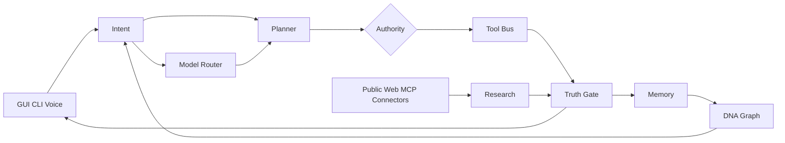
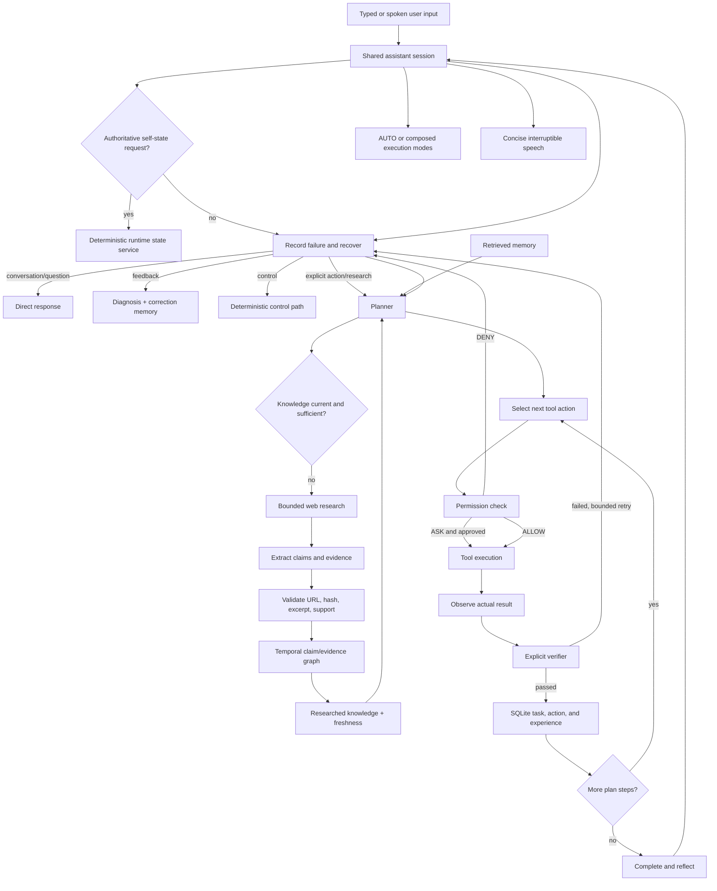

# Architecture

The system is intentionally one permission and evidence core with bounded specialist views. `app/runtime.py` wires configuration, providers, conversation, voice, tools, permissions, hybrid memory, planner, executor, verifier, vision, skills, scheduler, approvals, and role wrappers. Voice is an input/output adapter, not a second agent.

## Brain mesh and Operator Center

`app/brain_mesh.py` describes 14 operational nodes and 16 explicit contracts.
It keeps language generation, authority, execution, truth, and memory separate.
`brain_mesh_self_check` probes every node independently and then verifies that
the agent, state service, GUI, authority manager, document learner, and tool
executor share the intended live runtime objects. `brain_mesh_benchmark`
measures intent routing, model-route selection, memory health, tool inventory,
and team-contract latency without calling a generation model. The GUI Operator
Center renders those facts as live cards rather than asking a model to describe
itself.

Network and operator capability remains scoped. Public browsing, MCP reads,
and explicitly configured personal connectors are supported. A satellite or
other remote system can be integrated only through an owner-authorized,
documented API/connector for a system the owner is permitted to operate. HAYAT
does not crack software, bypass licenses/access controls, attack systems, or
convert untrusted web content into authority.

Key boundaries:

- `app/models/`: provider-neutral model interface and routing.
- `app/models/intelligent_router.py`: mode/privacy/modality/quality/latency/resource/warmth-aware primary and bounded fallback selection, updated only by verified task outcomes.
- `app/state.py`: authoritative provider, model, activity, project, tool, memory, research, voice, vision, and storage state assembled from live components; quick snapshots avoid deep inventory scans while explicit detailed snapshots populate a 60-second cache.
- `app/modes.py`: persistent AUTO or explicit composable execution-mode policy.
- `app/projects.py`: explicit active-project registry; no invented background project.
- `app/learning/`: prerequisite-aware topics, quizzes, weaknesses, safe declarative labs, mentor events, persistent learning queue, parent-controlled teaching boundary, and a cached cross-layer learning/alignment audit.
- `app/gui.py`: one desktop chat/voice/health/operational-trace surface around the authoritative runtime; it is not a second agent.
- `app/evaluation/` and `app/training/`: reusable evaluation reports and verified/provenance-gated future training data.
- `app/memory/retrieval.py`: cross-object SQLite retrieval metadata and versioned neural vectors for memory, procedures, claims, summaries, project documents, skills, and learning notes.
- `app/intent/` and `app/assistant.py`: structured meaning classification, false-action boundary, success criteria, and the unified text/voice entry point.
- `app/session.py`: shared application/window/file/browser/task references across typed and spoken turns.
- `app/tools/`: typed registry and concrete capabilities.
- `app/safety/`: static action policy, principal-aware runtime authority, bound approvals, protected paths, Administrator preflight, and project sandbox. Every registered tool passes through both static policy and authority, even when YAML says `ALLOW`.
- `app/memory/`: task state, conversations, hashed vectors, and episodic/semantic/procedural experience.
- `app/agent/`: context, planning, execution, verification, recovery, and reflection.
- `app/voice/`: devices, microphone, VAD, STT, session context, approvals, interruption, concise responses, TTS, wake phrase, and tray.
- `app/perception/`: screenshots, browser state, and configured multimodal interpretation; no fake vision.
- `app/research/`: knowledge-gap/query planning, provider-neutral search, public-only retrieval, deep inert-document download/extraction, bounded concurrency/crawling, query-specific ranking, source independence, strict citation validation, temporal claims, explainability, and durable knowledge/caches.
- `app/skills/`: declarative validation, untrusted learned candidates, and explicit trust promotion.
- `app/automation/`: persisted jobs, APScheduler triggers, and one-time approval reruns.
- `app/automation/event_engine.py`: durable event rules, filters, cooldowns, hourly caps, and background-principal execution.
- `app/integrations/`: OS-backed secret leases, connector catalog/gateway, official MCP client gateway, and authenticated localhost browser-extension bridge.
- `app/attachments.py`: bounded PDF/Office/text/image extraction and provenance-bearing hybrid-memory ingestion.
- `app/agents/`: manager plus explicit specialist delegation over the same security core.
- `app/windows/`: exact-window UI Automation and observable Notepad edit/close semantics.
- `app/storage/`: project quota, category accounting, local-model inventory, reserve enforcement, and conservative cleanup.
- `app/policy/`: fail-closed zero-cost provider policy; paid/cloud defaults cannot silently activate.
- `app/perception/camera/`: explicit camera lifecycle, cheap change detection, temporary-frame privacy, local OCR/vision adapters.
- `app/perception/displays.py` and `clipboard.py`: Win32 monitor/window state and ephemeral clipboard handling.
- `app/observability/`: local CPU/RAM/GPU/VRAM/disk and action-performance evidence plus all-tool static/historical/passive-probe benchmarking.
- `app/incidents/` and `app/learning/labs.py`: read-only infrastructure snapshots and safe project-local failure simulations.
- `app/events.py`: sanitized durable local events; task checkpoints and job executions provide restart evidence.
- `app/downloads/`: authoritative HTTPS, redirect, quota, hash, and audit controls without automatic execution.
- `app/models/diffusion.py` and `app/tools/images.py`: local image generation with quality presets, PNG verification, durable artifact manifest, content hashes, and legacy-artifact discovery.
- `app/learning/continuous.py`: durable topic queue plus idle-only bounded research under the `BACKGROUND_LEARNER` principal, fresh-knowledge reuse, verified knowledge storage, persistent budgets, and an external STOP-file kill switch.
- `app/learning/architecture.py`: read-mostly inventory across memory, research, teaching, procedures, and training; explicit trust/alignment checks; and non-destructive SQLite/index/cache maintenance with a durable audit artifact.

The visible “thinking” stream is an operational trace, not hidden model chain-of-thought. It is generated from real lifecycle events: routing, plan creation, selected tools, observed completion/failure, and verifier outcomes. `/thinking on` shows those facts live; `/thinking plan` and natural questions such as “what did you just do?” read the same recorded evidence.

Important actions are never considered complete merely because the model or tool says so. Every action has a step verifier, and the agent separately evaluates the user's final success criteria against accumulated observed evidence. Complex plans pass a structural critic before execution.
